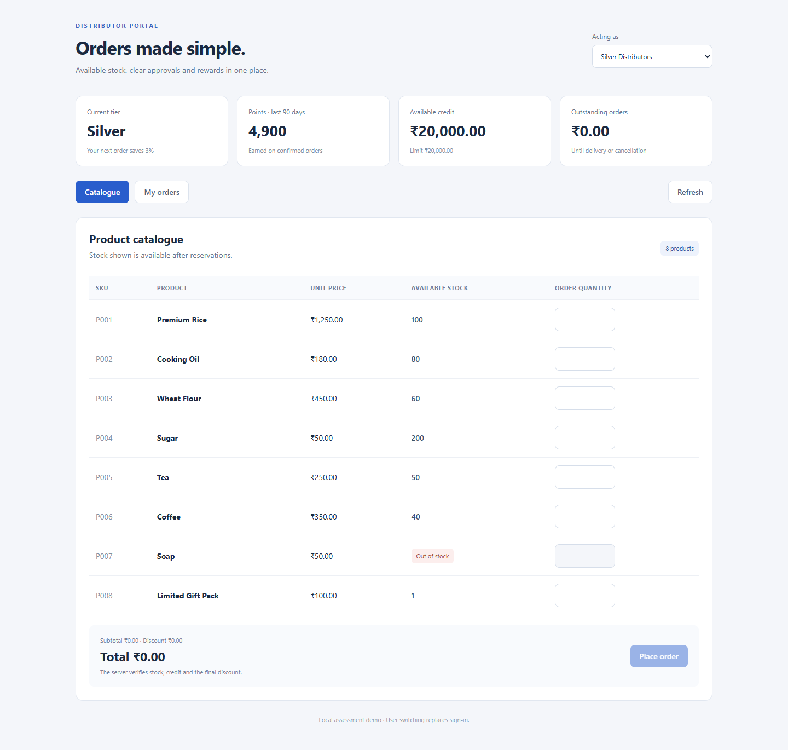
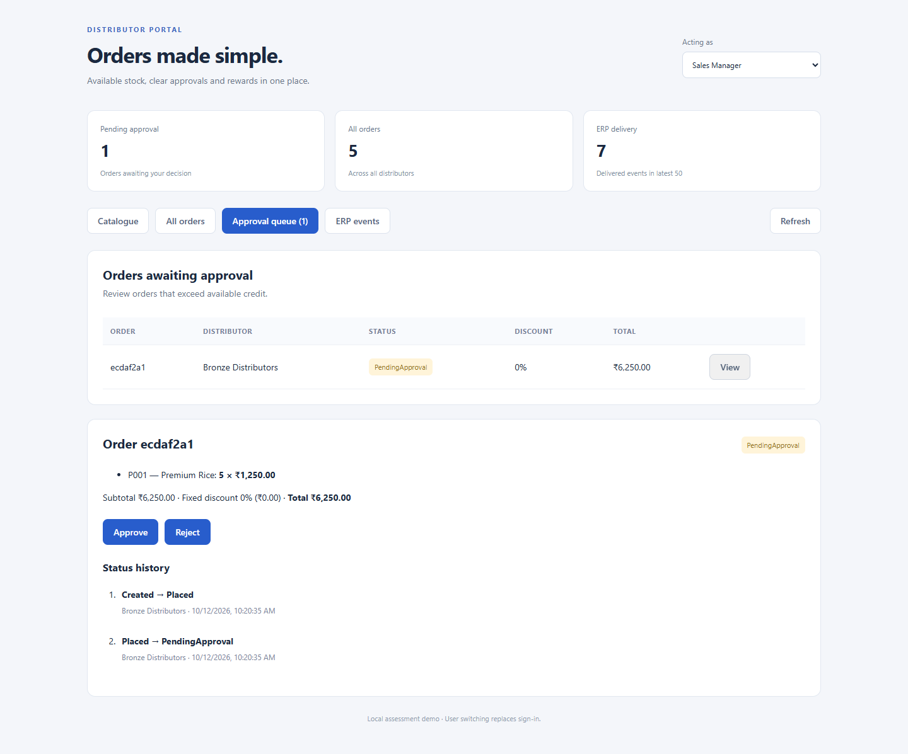
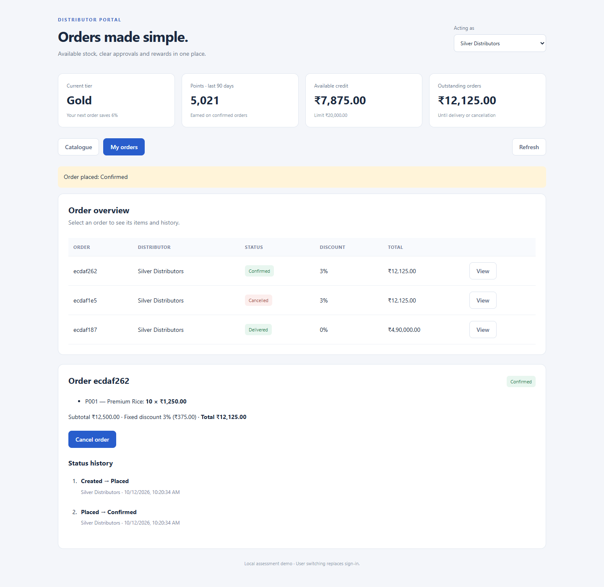

# 1. Orders without the confusion

Manufacturers need dependable stock visibility and consistent approval.
Distributors need clear prices, order progress and rewards.

Disconnected calls and spreadsheets make it difficult to see what is available, which orders need approval and how rewards were calculated.

---

# 2. Choose products with confidence

See available stock, choose quantities and review the discount before placing an order. Unavailable products remain visible without accepting orders.

---

# 3. Keep orders moving

Orders within available credit proceed automatically. Managers review larger orders, then approve or reject them and record dispatch and delivery.

---

# 4. Make rewards and progress clear

Every order shows its fixed discount and dated status history. Recent rewards determine the current tier. Eligible cancellations release stock and reverse rewards.

---

# 5. Prepare for launch

Agree the ERP connection, event format and duplicate-event handling. Import and reconcile products, opening stock, credit limits and recent reward history.

Add secure sign-in and operating controls. Pilot with a small distributor group, train managers and expand after reconciliation succeeds.
